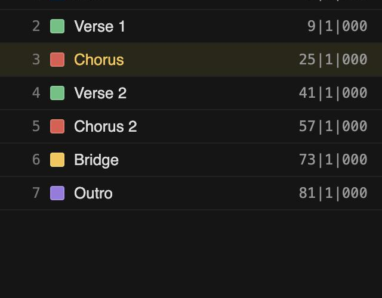

# Floating Markers

A simple, floating marker list for LUNA, made for fast recall from the numeric keypad, the way
Logic does it: press a marker's number and the playhead goes straight there.



## Use

Open it from **Add Ons > Windows > Floating Markers** while a session is open. It floats above
LUNA's windows, so it stays in reach while you work. It can also move into LUNA's browser panel.

- **Numpad 1, 2, 3…** go to that marker (two digits in quick succession reach 10 and up);
  **Shift** with a number loops, like Shift-click. **Numpad Enter** plays; **0** stops, then rewinds.
- **The keys light** (the **123** badge in the header) is lit while the window has the keyboard,
  so you know the numpad will reach it rather than LUNA. Hover over or click the window to give
  it the keyboard.
- **Click** a marker to move the playhead there. **Shift-click** a second marker to loop between them.
- **Double-click** a name to rename it; **Backspace** deletes the selected markers.

UA's own [Markers](https://github.com/uaudio-labs/markers) Add On is the full-featured one: a
browser panel with adding, comments, lengths, selection tools and Pro Tools-style recall. Floating
Markers does less on purpose: a small floating window, Logic-style number recall, and the numpad
as a transport.

## Install

**From LUNA:** paste `https://github.com/tait-adam/floating-markers` into **IMPORT URL** in LUNA's
Add On showcase. LUNA installs the latest release.

**From a download:** get `floating-markers.lunaaddon` from the
[latest release](https://github.com/tait-adam/floating-markers/releases/latest) and double-click it.
LUNA opens it and installs it.

**From source:** clone this repo, then `npm install` and `npx ua-builder install`.

Requires LUNA 3.1.2 or later.

## Development

| File | Purpose |
|---|---|
| `manifest.json` | What LUNA reads: id, name, window size, entry page. See the SDK's `docs/MANIFEST.md`. |
| `index.html` | The page. Loads the vendored SDK bundle, then `logic.js`, then `main.js`. |
| `logic.js` | Engine logic with no DOM. Tests run this against `Luna.MockEngine`. |
| `main.js` | DOM wiring: connect, follow the focused session, render. |
| `vendor/luna.global.js` | The SDK as a script-tag bundle (`globalThis.Luna`). Refreshed by `ua-builder pack`. |
| `tests/` | Vitest, no LUNA required. |

```sh
npm install
npm test                  # against the mock engine
npx ua-builder serve      # http://localhost:8790/ ; LUNA must be running to see live data
npx ua-builder install    # link into LUNA's Add Ons folder; appears in the Add Ons menu
npx ua-builder pack       # .lunaaddon file (a zip) for distribution
```

## License

MIT, see [LICENSE](LICENSE). `vendor/luna.global.js` is Universal Audio's LUNA Builder SDK
bundle, under its own Apache 2.0 license.
